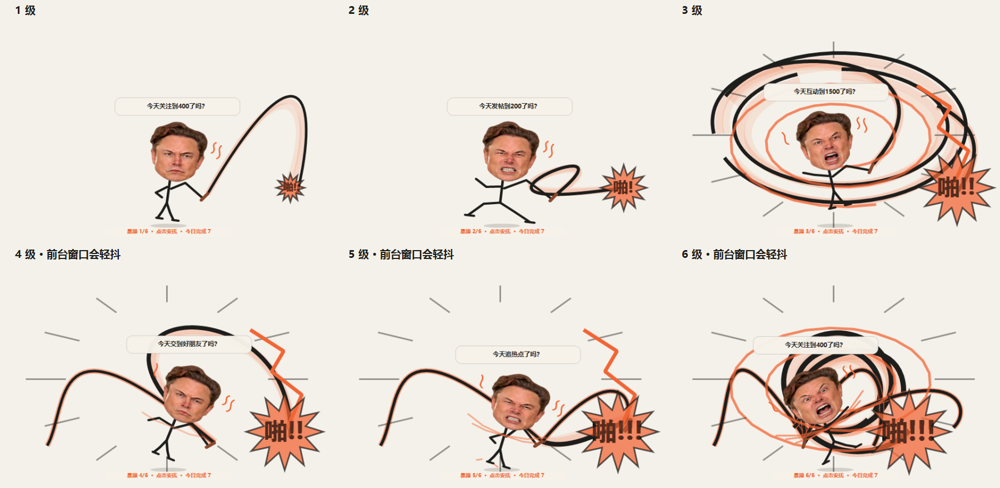

# X / WHIP

他负责催。你负责点一下。
到了下班时间，他先躺了。

一只待在 Windows 桌面上的马斯克大头火柴人。默认十五分钟催你去 X 营业，到点开始抽鞭。越不理他，场面越不讲道理。

[下载 Windows 安装包](https://github.com/roach01/x-whip/releases/latest) · [进门看看](https://roach01.github.io/x-whip/)



## 怎么用

安装后打开 X / WHIP。左键点他：今日完成 +1，收鞭，重新冷却。拖动只负责搬家，不加分。

右键有设置、试抽、暂停、上下班、去 X。卡皮芭拉好友入口和对应台词可在设置里一起关闭。

头上平时没字。闲逛二十到四十秒偶尔说一句，几秒后消失；抽鞭时也有讲话间隔。十六种照片表情都来自同一张基准照片，发型和打光保持一致。

## 越来越不像话

冷却分摸鱼、盯人、催促、蓄力四段。到点后每三抽升一级，总共六级。

1. 有点急。
2. 真急了。
3. 你倒是点一下啊。
4. 鞭子开始开会。前台窗口短暂轻抖。
5. 手臂已经不够用了。
6. 他是一个人，鞭子是一个部门。

八组姿势轮换：叉腰、后仰、双手、弓步、跺脚、跳起、绕身、自缠。四至六级让当前前台窗口短暂移位并还原，不使用桌面截图覆盖层；设置里可以关掉抖动。

## 营业话术

- 今天关注到400了吗？
- 今天发帖到200了吗？
- 今天互动到1500了吗？
- 今天交到好朋友了吗？
- 今天追热点了吗？
- 今天看“淡定的卡皮芭拉”首页了吗？（推广关闭后不出现）

点击计数由你手动确认，程序不连接 X 账号。每天北京时间零点清零，退出再开还记得今天的数字。

## 下班

默认北京时间 09:00–18:00，可修改或关闭自动时段，支持跨午夜。下班躺下戴墨镜，下一次上班重新冷却。

下班也能右键试抽。点一下加分并收鞭，回去继续躺，不会偷偷替你开新班。

## 安装与更新

Release 提供 `XWhipSetup-版本.exe` 安装包和 `XWhip-Portable-版本.zip` 免安装包。安装到当前用户目录，无需管理员权限。更新前右键退出旧宠物。

设置与每日计数保存在 `%LOCALAPPDATA%\XWhipPet\`，卸载后保留。安装包尚未配置代码签名证书。

## 自己编译

Windows 自带 .NET Framework 编译器即可编译，无需 NuGet。

```powershell
./scripts/build.ps1
./scripts/test.ps1
./scripts/package.ps1 -Iscc '你的 Inno Setup 6/ISCC.exe'
```

main 分支和 PR 自动编译、测试并生成安装包；推送 `v*` 标签自动发布 Release；介绍页使用 GitHub Actions 部署到 Pages。

照片出处与表情合成说明见 [PHOTO-CREDITS.md](assets/PHOTO-CREDITS.md)。这是民间桌面小玩具。
